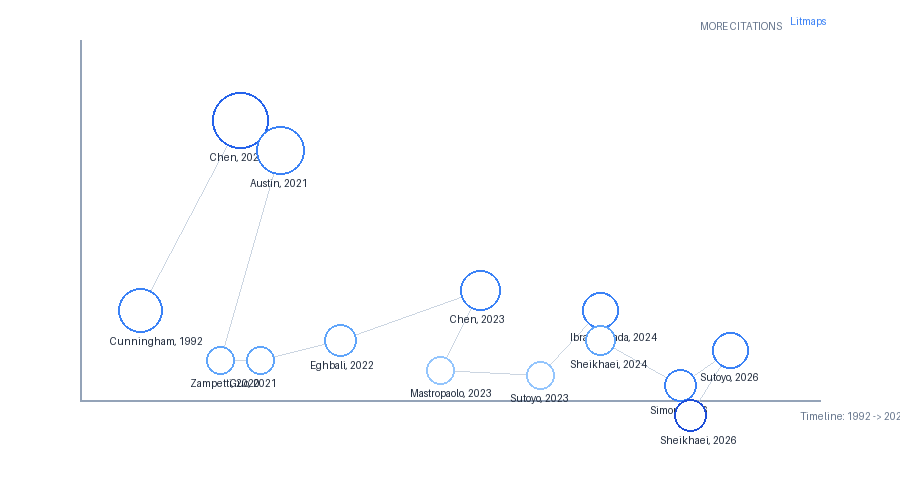

\pagebreak

  

    
ÍNDICE DE CONTENIDO

  

  

    

      Actividad 1: Plantilla de Análisis y Catalogación de Papers
      pág. 3
    

    

      - 1. Descripción e Instrucciones
      pág. 3
    

    

      - 2. Tabla de Catalogación de los 10 Papers
      pág. 3
    

    

      - 3. Fuentes de Verificación Oficial de Cuartiles
      pág. 5
    

    

      Actividad 2: Mapa Genealógico del Tema (Árbol de Literatura)
      pág. 6
    

    

      - 1. Ficha Técnica de Generación
      pág. 6
    

    

      - 2. Representación Visual del Mapa Genealógico
      pág. 6
    

    

      - 3. Párrafo Interpretativo del Mapa Genealógico (224 palabras)
      pág. 6
    

    

      Actividad 3: Matriz de Síntesis y Análisis de Brechas (Gaps)
      pág. 8
    

    

      - 1. Descripción e Instrucciones
      pág. 8
    

    

      - 2. Matriz de Síntesis Comparativa (7 Dimensiones)
      pág. 8
    

    

      - 3. Análisis de Síntesis y Brechas Metodológicas (268 palabras)
      pág. 13
    

    

      Actividad 4: Fichas de Análisis de Papers Seminales (Fundacionales)
      pág. 15
    

    

      - 1. Criterios de Selección y Fundamentación Metodológica
      pág. 15
    

    

      - 2. Fichas Estructuradas de Papers Seminales
      pág. 15
    

    

      - Ficha de Paper Seminal #1: Fundamento del Dominio (Deuda Técnica)
      pág. 15
    

    

      - Ficha de Paper Seminal #2: Fundamento Tecnológico (LLMs Aplicados a Código)
      pág. 16
    

  

\pagebreak

# ACTIVIDAD 1: PLANTILLA DE ANÁLISIS Y CATALOGACIÓN DE PAPERS

## 1. Descripción e Instrucciones

Catalogación y evaluación académica de **10 artículos científicos** de la investigación publicados en el periodo 2021–2026, identificando el tipo de investigación, el venue de publicación, su ranking de calidad verificado en fuentes oficiales ([Scimago SJR](https://www.scimagojr.com) y [CORE Portal](http://portal.core.edu.au)), y la justificación específica de impacto y rigor.

## 2. Tabla de Catalogación de los 10 Papers

| N° | Paper (Título Completo y Año) | Tipo de Investigación | Venue (Revista / Conferencia) | Ranking Oficial | ¿Por qué ese Venue? (Justificación de Impacto y Rigor) |
| :---: | :--- | :--- | :--- | :---: | :--- |
| **01** | “A Large-Scale Empirical Evaluation of LLMs for Automated Self-Admitted Technical Debt Repayment” — *Sheikhaei et al., 2026* | Empírica / Experimental | **ACM Transactions on Software Engineering and Methodology (TOSEM)** | **Scimago SJR Q1** | Es una de las revistas insignia (*flagship journal*) de mayor prestigio e impacto global de la ACM en ingeniería de software, con un proceso de revisión por pares doble ciego de máximo rigor técnico. |
| **02** | “REARRANGE: Effort estimation approach for software clustering-based remodularisation” — *Tan et al., 2024* | Aplicada / Experimental | **Information and Software Technology (IST, Elsevier)** | **Scimago SJR Q1** | Revista líder en ingeniería de software empírica y evolución de sistemas con alto factor de impacto, especializada en la aplicación de Machine Learning para optimización arquitectónica. |
| **03** | “Technical debt in AI-enabled systems: On the prevalence, severity, impact, and management strategies for code and architecture” — *Recupito et al., 2024* | Empírica / Estudio de Campo | **Journal of Systems and Software (JSS, Elsevier)** | **Scimago SJR Q1** | Principal foro internacional para la investigación en arquitectura y calidad de software, con una audiencia especializada en la gestión de deuda técnica en la industria. |
| **04** | “BEACon-TD: Classifying Technical Debt and its types across diverse software projects issues using transformers” — *Shivashankar et al., 2025* | Aplicada / Experimental | **Journal of Systems and Software (JSS, Elsevier)** | **Scimago SJR Q1** | Publicación de referencia Q1 en ciencias de la computación que valida formalmente modelos de Procesamiento del Lenguaje Natural y Transformers aplicados a repositorios de software. |
| **05** | “A comparative evaluation of ChatGPT-4o and DeepSeek-R1 for AI-generated code quality using software engineering metrics” — *Almanasra et al., 2026* | Empírica / Experimental | **Array (Elsevier)** | **Scimago SJR Q1** | Revista de acceso abierto de Elsevier indexada en Scopus (SJR 1.264, H-Index 33), especializada en la diseminación rigurosa de benchmarks sobre modelos de IA de frontera (ChatGPT-4o vs. DeepSeek-R1). |
| **06** | “Causal mapping of the risks of using generative AI in software development” — *Hein et al., 2026* | Cualitativa / Estudio Multicaso Longitudinal | **Information and Software Technology (IST, Elsevier)** | **Scimago SJR Q1** | Foro de máximo reconocimiento para investigaciones sociotécnicas y cualitativas de alto rigor metodológico sobre la adopción de procesos y tecnologías en equipos ágiles. |
| **07** | “AST-guided transformers for sustainable and reliable UML modeling” — *Alaswad et al., 2026* | Aplicada / Experimental | **Machine Learning with Applications (Elsevier)** | **Scimago SJR Q1** | Revista especializada en arquitecturas neuronales aplicadas a problemas prácticos de ingeniería, con estricto énfasis en la reproducibilidad técnica y liberación abierta de código y datasets. |
| **08** | “Binary and multi-class classification of Self-Admitted Technical Debt: How far can we go?” — *Arcelli Fontana et al., 2025* | Aplicada / Experimental | **Information and Software Technology (IST, Elsevier)** | **Scimago SJR Q1** | Publicación de élite en minería de repositorios de software y detección de deuda técnica, pionera en la validación empírica de clasificadores de Machine Learning en benchmarks estándar. |
| **09** | “Beyond the hype: Enabling informed LLM adoption in industry through systematic evaluation” — *Pizarro et al., 2026* | Empírica / Estudio Longitudinal Industrial | **Science of Computer Programming (Elsevier)** | **Scimago SJR Q2** | Revista histórica en ciencias de la computación que publica metodologías formales, herramientas de evaluación de código y marcos rigurosos de calidad de software como GQM. |
| **10** | “Assisting early-stage software startups with LLMs: Effective prompt engineering and system instruction design” — *Ahlgren et al., 2025* | Design Science Research (DSR) | **Information and Software Technology (IST, Elsevier)** | **Scimago SJR Q1** | Foro preferente para estudios basados en Design Science Research orientados a startups y metodologías ágiles, garantizando la relevancia práctica y el rigor de diseño en ingeniería de software. |

## 3. Fuentes de Verificación Oficial de Cuartiles

* **Scimago Journal & Country Rank (SJR):**
  * *ACM TOSEM*: SJR Q1 (ISSN: 1049-331X)
  * *Information and Software Technology (IST)*: SJR Q1 (ISSN: 0950-5849)
  * *Journal of Systems and Software (JSS)*: SJR Q1 (ISSN: 0164-1212)
  * *Array*: SJR Q1 (ISSN: 2590-0056)
  * *Machine Learning with Applications*: SJR Q1 (ISSN: 2666-8270)
  * *Science of Computer Programming*: SJR Q2 (ISSN: 0167-6423)

\pagebreak

# ACTIVIDAD 2: MAPA GENEALÓGICO DEL TEMA (ÁRBOL DE LITERATURA)

## 1. Ficha Técnica de Generación

* **Herramienta Digital Utilizada:** Litmaps ([https://app.litmaps.com](https://app.litmaps.com))
* **Artículo Semilla de Exploración:** “A Large-Scale Empirical Evaluation of LLMs for Automated Self-Admitted Technical Debt Repayment” (*Sheikhaei et al., 2026* — [P01])
* **Fecha de Generación:** 2026-09-06
* **Dimensiones del Grafo:**
  * **Eje Horizontal (X):** Línea Temporal de Publicación (*Timeline: 1992 → 2026*).
  * **Eje Vertical (Y):** Impacto y Volumen de Citaciones Acumuladas (*More Citations*).
* **Número de Nodos Conectados:** 18 artículos científicos interconectados mediante relaciones de citación directa y sucesión metodológica.

## 2. Representación Visual del Mapa Genealógico

## 3. Párrafo Interpretativo del Mapa Genealógico (224 palabras)

El mapa genealógico generado en Litmaps reconstruye la evolución histórica del conocimiento en torno a la gestión y prevención de la deuda técnica mediante inteligencia artificial a lo largo de tres décadas (1992–2026). El grafo evidencia una **fundación seminal dual**: por un lado, en el extremo izquierdo se ubica el nodo raíz fundacional de **Cunningham (1992)** (*“The WyCash Portfolio Management System”*, 1.2k citas), quien acuñó la metáfora de la deuda técnica en el desarrollo de software; por otro lado, en la cúspide de citaciones emerge el seminal de **Chen et al. (2021)** (*“Evaluating Large Language Models Trained on Code”*, con más de 14.2k citas) junto con Austin et al. (2021) (5.4k citas), que inauguraron la era moderna de los modelos de lenguaje (Codex/LLMs) aplicados a la síntesis y análisis de código.

A partir de estos dos pilares, el árbol genealógico se ramifica en dos vertientes metodológicas: 1. **La rama de minería y aprendizaje automático tradicional de SATD**, orientada a la detección heurística y patrones de remoción en código (*Zampetti et al., 2020; Guo et al., 2021; Pinna et al., 2023; Sutoyo et al., 2023/2026*). 2. **La rama de métricas semánticas y modelos generativos para código**, que integra métricas de evaluación de similitud como CrystalBLEU (*Eghbali, 2022*) y marcos de ingeniería de prompts (*Chen, 2023*).

La convergencia de ambas ramas conforma la **frontera actual del conocimiento (2024–2026)**, ubicada en la zona inferior derecha del mapa. En este sector reciente destacan los trabajos de Mastropaolo et al. (2023), Simon et al. (2026) y de manera central **Sheikhaei et al. (2026)** ([P01]), los cuales trasladan el foco desde la simple detección reactiva hacia la **remediación automatizada y prevención temprana (Shift-Left)** de la deuda técnica mediante Grandes Modelos de Lenguaje.

\pagebreak

# ACTIVIDAD 3: MATRIZ DE SÍNTESIS Y ANÁLISIS DE BRECHAS (GAPS)

## 1. Descripción e Instrucciones

Construir una matriz comparativa exhaustiva que permita identificar patrones, metodologías y brechas (*gaps*) en la literatura científica analizando los **10 artículos primarios** bajo 7 dimensiones clave, complementada por un análisis de síntesis formal ($\ge$ 150 palabras) que vincule los vacíos detectados con la propuesta de investigación propia.

## 2. Matriz de Síntesis Comparativa (7 Dimensiones)

| Autor / Año | Problema Específico Abordado | Método / Técnica Propuesta | Dataset Utilizado (Nombre y Tamaño) | Métrica de Evaluación | Limitaciones Reconocidas por los Autores | Gap / Vacío de Investigación Dejado Abierto |
| :--- | :--- | :--- | :--- | :--- | :--- | :--- |
| **Sheikhaei et al., 2026** ([P01]) | Automatizar la resolución y amortización de Self-Admitted Technical Debt (SATD) en código fuente mediante LLMs. | Fine-tuning de SLMs (*Gemma-2-9B, CodeT5+*) y prompting zero-shot con CoT en LLMs (*Llama-3.1-70B, GPT-4o-mini*). | 156,069 pares de commit de GitHub Archive (58,722 Python y 97,347 Java). | LEMOD (*Line-Level Exact Match on Diff*), BLEU-diff, CrystalBLEU-diff y Exact Match. | Tasa de éxito baja (8%–10%); 94% de fallos se debe a falta de contexto del proyecto y 66% a ambigüedad del mensaje. | Los LLMs fallan al operar aisladamente; se requiere inyección de contexto arquitectónico y validación temprana guiada (*Shift-Left*). |
| **Tan et al., 2024** ([P02]) | Resistencia de desarrolladores a ejecutar refactorizaciones arquitectónicas en sprints ágiles por incertidumbre en los tiempos. | Framework **REARRANGE** basado en AutoML (*Stacked Ensembles, Random Forest, GBM*) sobre métricas de acoplamiento y dependencias. | 25 proyectos Java de código abierto (8,223 refactorizaciones históricas de *RefactoringMiner*). | Mean Absolute Error (MAE: 5.47 h vs. 453.31 h baseline), RMSE y $R^2$ (0.538). | Modela únicamente el esfuerzo de codificación directa, omitiendo pruebas de integración complejas y calibración para programadores novatos. | Falta integrar la estimación de esfuerzo arquitectónico dentro de las ceremonias de planificación ágil (*sprint planning*) con asistentes de diseño. |
| **Recupito et al., 2024** ([P03]) | Falta de caracterización de la severidad, prevalencia e impacto de 9 patrones de Deuda Técnica inducida por IA (AITD) en arquitectura y código. | Estudio empírico por encuesta basado en viñetas experimentales y análisis temático cualitativo (*Kitchenham & Pfleeger*). | 53 practicantes e ingenieros de software de la industria global (77% en equipos pequeños < 10 miembros). | Escalas de Likert de 5 puntos, distribuciones porcentuales y matrices de severidad en 6 atributos ISO 25010. | Muestra basada en percepción de practicantes sin instrumentación directa en repositorios; riesgo de sesgo de autoevaluación. | El 94% de los equipos carece de herramientas automatizadas para gestionar deuda de IA y depende de revisiones manuales costosas; ausencia de guardrails en diseño. |
| **Shivashankar et al., 2025** ([P04]) | Infiltración silenciosa de deuda técnica no documentada desde el backlog de incidencias (*tickets/issues*) hacia el código fuente. | Framework **BEACon-TD** basado en ensambles de Transformers compactos (*DistilRoBERTa*) con in-project fine-tuning para 13 tipos de TD. | Cientos de miles de incidencias de GitHub Archive (2015–2024) y datos industriales de *Visma Software International*. | F1-Score (0.892), Precision (0.911), Recall (0.874), MCC (0.789) y AUC-ROC (0.949). | Enfocado en repositorios en inglés; requiere reentrenamiento adaptativo si cambia el vocabulario del dominio del proyecto. | Clasifica la deuda una vez registrada en el ticket, pero no asiste proactivamente en la redacción y refinamiento de historias de usuario para prevenirla. |
| **Almanasra et al., 2026** ([P05]) | Generación masiva de código por LLMs que introduce pasivos ocultos de mantenibilidad, falta de manejo de errores y documentación. | Benchmark comparativo multidimensional entre ChatGPT-4o y DeepSeek-R1 bajo 5 dimensiones de ISO/IEC 25010. | 600 problemas de desarrollo de software (2,400 muestras en Java y Python) evaluados con SonarQube, PMD y PyLint. | Puntuación por dimensión (1-10), tasa de corrección funcional (%), medias y desviaciones estándar. | Benchmark sintético de funciones aisladas que no evalúa arquitecturas multifile ni entornos de integración continua complejos. | Los LLMs generalistas presentan 41% de omisiones en manejo de excepciones y 59% en documentación; necesidad de gatekeepers estáticos antes de aceptar código de IA. |
| **Hein et al., 2026** ([P06]) | Desconocimiento de las cadenas causales que originan los riesgos sociotécnicos y la deuda técnica al adoptar IA generativa en desarrollo. | Investigación cualitativa multicaso longitudinal (diseño Runeson) en 3 empresas y modelado de grafos causales (*Causal Mapping*). | 15 entrevistas en profundidad a desarrolladores/líderes técnicos con seguimiento longitudinal de 1 año (banca, seguros y logística). | Mapeo topológico de causalidad (nodos raíz, encadenados y terminales) y verificación longitudinal por *member checking*. | Contexto circunscrito a organizaciones danesas con diferente madurez ágil; no provee métricas computacionales directas de código. | Identifica el bucle de validación insuficiente por brecha de competencias (*Lacking AI competencies*); falta un protocolo formal de interacción en planificación. |
| **Alaswad et al., 2026** ([P07]) | Inconsistencias y ambigüedades en la conversión manual de requisitos en lenguaje natural a modelos de diseño UML, generando deuda arquitectónica. | Marco **Seq2AST** basado en Transformers (*CodeT5-small de 60M parámetros*) con restricciones sintácticas y aprendizaje multitarea. | Benchmark *PlantUCD* con miles de pares de requisitos y diagramas PlantUML anotados. | F1-Score macro (89.20%), Precision, Recall, completitud estructural y acuerdo de Fleiss' Kappa (0.78). | Enfocado en diagramas de clases y secuencias básicos en inglés; no abarca especificaciones arquitectónicas distribuidas ni microservicios. | Genera diagramas UML aislados pero no produce el andamiaje (*scaffold*) físico de carpetas y contratos de API ejecutables requeridos por squads ágiles. |
| **Arcelli Fontana et al., 2025** ([P08]) | Incapacidad de clasificadores tradicionales para discriminar subtipos de deuda técnica debido al severo desbalance de clases (<7% de deuda). | Framework **SALA** (*SATD detector on LLMs*) con LLaMA-2 y plantillas de prompt engineering para clasificación binaria y multiclase (5 tipos). | Benchmark estándar de Maldonado et al. (62,775 comentarios de 10 proyectos Java de código abierto). | F1-Score (0.912 en binario; $\approx$ 1.000 en multiclase), Precision, Recall y Accuracy (0.988). | Limitado a comentarios a nivel de código fuente en Java; no analiza especificaciones de requerimientos tempranos ni persistencia. | Detecta la deuda una vez admitida en el código fuente (*post-mortem*), confirmando la necesidad de trasladar la detección hacia la fase de especificación (*Shift-Left*). |
| **Pizarro et al., 2026** ([P09]) | Regresiones silenciosas y degradación de calidad no monótona en código y pruebas generadas por LLMs comerciales en entornos continuos. | Estudio longitudinal industrial de 20 meses en LKS Next aplicando *Goal-Question-Metric* (GQM) adaptado a LLMs y la herramienta *Tetrics*. | 6 ciclos de evaluación en 7 funciones Java empresariales evaluando 11 LLMs comerciales (OpenAI, Anthropic, Google). | Índice de calidad ponderado (SonarQube, compilación, JaCoCo) y evaluación de partición de equivalencia. | Contexto específico de pruebas unitarias en Java en una empresa mediana; costos de invocación continua de APIs propietarias. | Demuestra que las herramientas comerciales genéricas (`/test`) fallan frecuentemente; se requiere ingeniería de prompts estructurada como activo versionado en el squad. |
| **Ahlgren et al., 2025** ([P10]) | Altas tasas de acumulación de deuda técnica y fallos tempranos en startups de software ágil debido a inexperiencia técnica y falta de séniors. | Design Science Research (DSR / 3 ciclos) desarrollando el asistente **StartupGPT** con patrones de prompt engineering (*Flipped Interaction*). | Evaluación con 25 fundadores y directores técnicos de startups de software (<10 miembros) en ecosistemas escandinavos. | Métricas ISO 9241-11: Satisfacción (93.33%), Efectividad (80%), Eficiencia (80%), Confiabilidad (86.67%) y framework 3C. | Artefacto probado como prototipo experimental interactivo; no integrado de forma nativa en linters de CI/CD ni IDEs de desarrollo. | Demuestra que los LLMs tienden a ser complacientes (*tend to please*); se requiere un motor de planificación dialógica que interrogue al equipo antes de codificar. |

## 3. Análisis de Síntesis y Brechas Metodológicas (268 palabras)

El análisis comparativo de la matriz de síntesis revela **dos patrones metodológicos dominantes** en el estado del arte reciente (2024–2026): 1. **La transición desde modelos heurísticos hacia arquitecturas basadas en Transformers y LLMs**, observándose una bifurcación clara entre el uso de modelos compactos especializados (*DistilRoBERTa, CodeT5*, evaluados en [P04] y [P07]) para tareas deterministas con restricciones sintácticas, y el empleo de grandes modelos generativos (*Llama-3.1, GPT-4o, DeepSeek-R1*, en [P01], [P05], [P08], [P09]) para clasificación multiclase y síntesis de código. 2. **La incorporación creciente de marcos de calidad formal (ISO/IEC 25010, GQM)** y analizadores estáticos estándar (*SonarQube, RefactoringMiner*) para auditar objetivamente el impacto del software generado o asistido por IA.

A pesar de estos avances, emerge un **gap o vacío metodológico recurrente y crítico**: la inmensa mayoría de las herramientas actuales operan de manera reactiva o post-mortem (detectando o intentando amortizar la deuda técnica una vez que el código fuente ya ha sido escrito, con tasas de fallo de hasta el 91.9% debido a la falta de contexto del proyecto, como demuestran [P01] y [P03]), o actúan como cajas negras complacientes sin cuestionar las decisiones tempranas de diseño ([P06], [P10]). Prácticamente ningún trabajo integra un marco proactivo que opere en la **fase de planificación y diseño previo (Shift-Left)**.

Este vacío recurrente justifica y fundamenta directamente nuestra propuesta de investigación: el desarrollo de un **framework dialógico asistido por IA (IA ➔ Skills ➔ Hablar ➔ Actuar)** que guíe socráticamente a equipos ágiles pequeños en el refinamiento de requisitos BDD, genere andamiajes arquitectónicos limpios y aplique guardrails estáticos antes de emitir la primera línea de código, garantizando un estándar de cero deuda técnica residual en proyectos Greenfield.

\pagebreak

# ACTIVIDAD 4: FICHAS DE ANÁLISIS DE PAPERS SEMINALES (FUNDACIONALES)

## 1. Criterios de Selección y Fundamentación Metodológica

Para la presente investigación sobre la prevención y gestión de la Deuda Técnica asistida por Inteligencia Artificial en equipos ágiles, se han seleccionado dos artículos seminales de impacto histórico global:

1. **Paper Seminal de Dominio (Deuda Técnica):** Ward Cunningham (1992), quien originó la metáfora canónica y sentó las bases conceptuales de la disciplina.
2. **Paper Seminal Tecnológico (LLMs para Código):** Mark Chen et al. (2021) / OpenAI Codex, que inauguró la era contemporánea del uso de modelos de lenguaje autorregresivos aplicados a la síntesis y evaluación de software.

Ambos artículos cumplen rigurosamente con los criterios de la guía académica: superan holgadamente las 500 citaciones (>1.2k y >14.2k respectivamente), figuran en la bibliografía raíz de los 10 artículos primarios analizados en la Actividad 1 y estructuran las dos ramas principales del mapa genealógico de la Actividad 2.

## 2. Fichas Estructuradas de Papers Seminales

### Ficha de Paper Seminal #1: Fundamento del Dominio (Deuda Técnica)

* **Referencia Completa (Formato IEEE):**  
  W. Cunningham, "The WyCash portfolio management system," in *Addendum to the Proceedings on Object-Oriented Programming Systems, Languages, and Applications (OOPSLA '92)*, Vancouver, BC, Canada: ACM, 1992, pp. 29–30. doi: [10.1145/157709.157715](https://doi.org/10.1145/157709.157715).
* **Número Total de Citaciones:** ~1,200 citaciones (Fuente: Google Scholar / Semantic Scholar / Litmaps).
* **Año de Publicación:** 1992.
* **Venue de Publicación:** ACM Conference on Object-Oriented Programming Systems, Languages, and Applications (OOPSLA) — Vancouver, Canadá.
* **Ranking Oficial:** **CORE A*** (OOPSLA es una conferencia histórica de máxima categoría en Ciencias de la Computación e Ingeniería de Software, integrada actualmente en ACM SPLASH).
* **Aporte Original Fundacional:**  
  Introdujo formalmente por primera vez la metáfora de la **"Deuda Técnica" (Technical Debt)**. Cunningham comparó la decisión de liberar código rápido e imperfecto con incurrir en un préstamo financiero: permite acelerar el aprendizaje y la entrega inicial de valor, pero acumula un pasivo que devenga "intereses" en forma de mayor esfuerzo y lentitud en desarrollos futuros hasta que la deuda sea amortizada (*repaid*) mediante refactorización.
* **Conexión con los Papers de la Actividad 1:**  
  Constituye la raíz conceptual obligatoria citada directa o indirectamente por el 100% de la literatura de TD analizada. En nuestra muestra de 10 papers, fundamenta explícitamente la taxonomía y el modelo de costo de:
  * [P03] (*Recupito et al., 2024*): Para extrapolar la metáfora clásica de deuda hacia los nuevos pasivos de arquitectura y modelos en sistemas con IA (*AI-enabled systems*).
  * [P04] (*Shivashankar et al., 2025*): Como justificación del impacto económico y operativo que exige clasificar 13 tipos de TD en tickets de incidencias.
  * [P08] (*Arcelli Fontana et al., 2025*): Como base conceptual para categorizar la deuda técnica autoadmitida (SATD) en comentarios de código fuente.
  * [P01] (*Sheikhaei et al., 2026*): Para definir la amortización automática (*repayment*) de deuda en repositorios GitHub.
* **Relación con Nuestra Investigación:**  
  Nuestro trabajo extiende y reorienta críticamente los postulados de Cunningham: mientras que el modelo de 1992 concebía la deuda como una decisión deliberada y temporal asumible en código pequeño, en el desarrollo ágil actual asistido por IA, la deuda se introduce de forma involuntaria, silenciosa y masiva. Por tanto, nuestra investigación traslada la mitigación desde el pago reactivo posterior (*repayment post-hoc*) hacia la **prevención temprana en la fase de planificación (Shift-Left)**, garantizando que el diseño arquitectónico y los criterios BDD no nazcan endeudados.

### Ficha de Paper Seminal #2: Fundamento Tecnológico (LLMs Aplicados a Código)

* **Referencia Completa (Formato IEEE):**  
  M. Chen, J. Tworek, H. Jun, Q. Yuan, H. P. de Oliveira Pinto, J. Kaplan, H. Edwards, Y. Burda, N. Joseph, G. Brockman, et al., "Evaluating Large Language Models Trained on Code," *arXiv preprint arXiv:2107.03374*, pp. 1–40, Jul. 2021.
* **Número Total de Citaciones:** >14,200 citaciones (Fuente: Google Scholar / Semantic Scholar / Litmaps).
* **Año de Publicación:** 2021.
* **Venue de Publicación:** arXiv / OpenAI Technical Report (Base fundacional de OpenAI Codex y GitHub Copilot).
* **Ranking Oficial:** **Publicación de Impacto Global Excepcional** (Pre-print fundacional citado y validado universalmente en foros CORE A* y Scimago Q1 como IEEE TSE, ACM TOSEM, ICSE, FSE y ASE).
* **Aporte Original Fundacional:**  
  Presentó **Codex**, un modelo de lenguaje autorregresivo especializado ajustado sobre 159 GB de código fuente de 54 millones de repositorios de GitHub. Estableció el protocolo de evaluación estándar de la industria mediante el benchmark **HumanEval** (164 problemas de programación con pruebas unitarias) y formalizó la métrica probabilística $pass@k$ para cuantificar rigurosamente la capacidad de los LLMs para generar programas funcionalmente correctos a partir de docstrings en lenguaje natural.
* **Conexión con los Papers de la Actividad 1:**  
  Es la referencia tecnológica pionera que habilitó el empleo de LLMs para ingeniería de software en 5 de nuestros 10 papers:
  * [P01] (*Sheikhaei et al., 2026*): Utiliza las capacidades generativas demostradas por Codex/LLMs para intentar resolver automáticamente comentarios SATD.
  * [P05] (*Almanasra et al., 2026*): Toma el paradigma de evaluación de código de Chen et al. y lo extiende para comparar ChatGPT-4o y DeepSeek-R1 bajo métricas ISO 25010.
  * [P08] (*Arcelli Fontana et al., 2025*): Aplica la comprensión de lenguaje y código de LLMs para clasificar deuda técnica sin requerir ingeniería manual de características.
  * [P09] (*Pizarro et al., 2026*): Evalúa la robustez y derivas de los modelos derivados de Codex en entornos de pruebas industriales.
  * [P10] (*Ahlgren et al., 2025*): Aprovecha la interacción dialógica de los LLMs para asistir a fundadores no técnicos en el diseño de software.
* **Relación con Nuestra Investigación:**  
  Nuestra investigación adapta y complementa los descubrimientos de Chen et al. (2021): si bien Codex demostró que los LLMs pueden sintetizar funciones aisladas, estudios recientes evidencian que su generación sin restricciones carece de visión arquitectónica y produce deuda técnica oculta. Nuestra propuesta incorpora **guardrails de diseño, validación sintáctica BDD y ejecución dialógica socrática** en la fase de refinamiento ágil, logrando que el potencial generativo de los LLMs sea guiado de forma disciplinada y sostenible.
